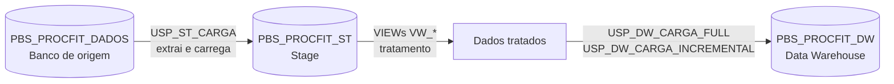
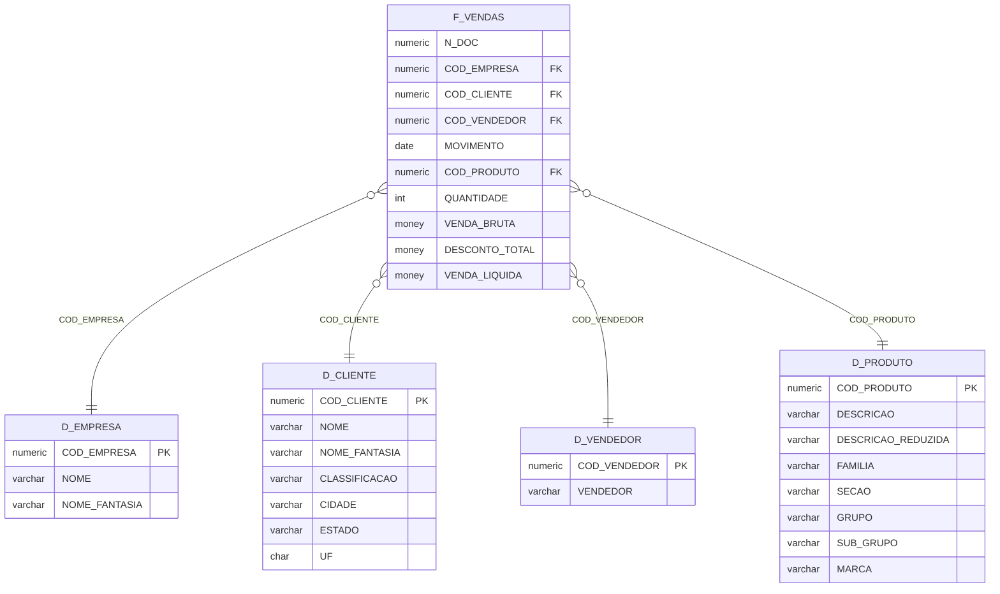

# 🏢 Projeto Data Warehouse em SQL Server — Stage (ST) + DW

Projeto de modelagem e carga de um **Data Warehouse** em **SQL Server (T-SQL)**, construído a partir de um banco transacional de vendas. Os dados passam por uma **área de Stage (ST)**, onde são extraídos e tratados, antes de chegarem ao **DW**, organizado em **modelo estrela** (tabelas dimensão + tabela fato).

> 💡 **Data Mart x Data Warehouse:** o Data Warehouse é o repositório analítico central e integrado da empresa; o Data Mart é um subconjunto dele, focado em uma área de negócio (por exemplo, Vendas). Este projeto implementa o DW com o assunto **Vendas**, que pode ser exposto como um Data Mart para essa área.

---

## 🎯 Objetivo

Separar o processamento analítico do banco transacional, entregando dados **limpos, padronizados e prontos para consumo** (BI, relatórios e consultas) sem pesar no sistema de origem.

---

## 🏗️ Arquitetura

Três bancos de dados, cada um com uma responsabilidade:



| Camada         | Banco               | Responsabilidade                                                                      |
| -------------- | ------------------- | ------------------------------------------------------------------------------------- |
| **Origem**     | `PBS_PROCFIT_DADOS` | Banco transacional (somente leitura para o pipeline)                                  |
| **Stage (ST)** | `PBS_PROCFIT_ST`    | Cópia dos dados de origem em tabelas `ST_*` e **tratamento** por meio de views `VW_*` |
| **DW**         | `PBS_PROCFIT_DW`    | Dimensões (`D_*`) e fato (`F_*`) no modelo estrela                                    |

### Por que usar uma área de Stage?

- **Protege a origem:** a extração é feita uma vez, de forma simples (`TRUNCATE` + `INSERT`), sem regras pesadas rodando no sistema transacional.
- **Isola o tratamento:** toda a limpeza fica nas views da Stage, e o DW só recebe dado já pronto (`SELECT *` da view).
- **Facilita a manutenção:** se uma regra muda, altera-se uma view, sem mexer na carga do DW.

---

## ⭐ Modelo dimensional (Esquema Estrela)



- **Fato:** `F_VENDAS`, com granularidade por documento, produto e movimento, e as métricas quantidade, venda bruta, desconto total e venda líquida.
- **Dimensões:** `D_CLIENTE`, `D_PRODUTO`, `D_EMPRESA` e `D_VENDEDOR`.
- **Integridade:** a fato possui chaves estrangeiras para todas as dimensões.
- **Dimensão de calendário:** a função `FN_MONTAR_D_CALENDARIO` gera uma tabela de datas completa (ano, trimestre, mês, semana, ano fiscal, offsets em relação a hoje, etc.).

---

## 🔄 Fluxo de carga (ETL)

### 1️⃣ Extração para a Stage — `USP_ST_CARGA`

Orquestra uma procedure por assunto:

| Procedure                          | Tabelas ST carregadas                                                                       | Observação                                    |
| ---------------------------------- | ------------------------------------------------------------------------------------------- | --------------------------------------------- |
| `USP_ST_CARGA_CLIENTE`             | `ST_CLIENTES`, `ST_CLIENTES_CLASSIFICACOES`, `ST_CLIENTES_ENDERECOS`, `ST_CLIENTES_ESTADOS` | Cliente é espalhado em 4 tabelas na origem    |
| `USP_ST_CARGA_EMPRESA`             | `ST_EMPRESAS`                                                                               |                                               |
| `USP_ST_CARGA_PRODUTO`             | `ST_PRODUTOS`                                                                               | Junta família, seção, grupo, subgrupo e marca |
| `USP_ST_CARGA_VENDEDOR`            | `ST_VENDEDORES`                                                                             |                                               |
| `USP_ST_CARGA_VENDA(@INCREMENTAL)` | `ST_VENDAS`                                                                                 | Aceita carga full (`0`) ou incremental (`1`)  |

Cada procedure é **autossuficiente**: cria a tabela se não existir, limpa a Stage (`TRUNCATE`) e repopula. Também existem `USP_ST_CARGA_INCREMENTAL` (só vendas incremental) e `USP_LIMPAR_ST` (limpa toda a Stage).

### 2️⃣ Tratamento — Views `VW_*` (na Stage)

Cada dimensão e a fato têm uma view que entrega o dado final ao DW:

- **Registro "Não Informado":** cada dimensão recebe uma linha de código `0` (`Não Informado`/`Não Informada`/`ND`) via `UNION ALL`. Valores nulos nas chaves da fato apontam para ela, **evitando perda de linhas** em `JOIN`s.
- **Padronização de texto:** a função `FN_CAMEL_CASE` converte textos para o formato "Nome Próprio" (ex.: `JOÃO DA SILVA` → `João Da Silva`).
- **Tratamento de nulos:** `ISNULL` nos campos descritivos e nas chaves.
- **Regra de negócio:** `DESCONTO_TOTAL = DESCONTO + DESCONTO_NEGOCIADO`.
- **Denormalização:** a view de clientes junta classificação, cidade e estado em uma única linha, no formato da dimensão.

| View              | Origem                                               | Destino no DW |
| ----------------- | ---------------------------------------------------- | ------------- |
| `VW_D_CLIENTES`   | `ST_CLIENTES` + classificações + endereços + estados | `D_CLIENTE`   |
| `VW_D_PRODUTOS`   | `ST_PRODUTOS`                                        | `D_PRODUTO`   |
| `VW_D_EMPRESAS`   | `ST_EMPRESAS`                                        | `D_EMPRESA`   |
| `VW_D_VENDEDORES` | `ST_VENDEDORES`                                      | `D_VENDEDOR`  |
| `VW_F_VENDAS`     | `ST_VENDAS`                                          | `F_VENDAS`    |

### 3️⃣ Carga no DW

**Carga full — `USP_DW_CARGA_FULL`** (ordem respeita as chaves estrangeiras: dimensões primeiro, fato por último):

```sql
EXEC USP_FULL_D_CLIENTE
EXEC USP_FULL_D_EMPRESA
EXEC USP_FULL_D_PRODUTO
EXEC USP_FULL_D_VENDEDOR
EXEC USP_CARGA_F_VENDAS 0
```

**Carga incremental — `USP_DW_CARGA_INCREMENTAL`:**

```sql
EXEC USP_CARGA_F_VENDAS 1
```

Na carga incremental, apenas a fato recebe dados novos: só entram vendas com `MOVIMENTO` maior que a última data já existente em `F_VENDAS`.

### Duas estratégias para popular as dimensões

Para cada dimensão o projeto traz as duas abordagens:

| Estratégia                | Como funciona                                                | Quando usar                                 |
| ------------------------- | ------------------------------------------------------------ | ------------------------------------------- |
| **`TRUNCATE` + `INSERT`** | Apaga tudo e recarrega                                       | Dimensões pequenas, simplicidade            |
| **`MERGE`**               | `UPDATE` quando o registro já existe, `INSERT` quando é novo | Preserva a tabela e atualiza só o que mudou |

---

## 📁 Estrutura do repositório

```
12_projeto_data_mart_x_data_warehouse/
├── FN Camel Case/
│   └── FN_CAMEL_CASE.sql              # função de padronização de texto
├── ST/                                # Stage Area (PBS_PROCFIT_ST)
│   ├── ST_CLIENTES/                   # tabelas, carga e view VW_D_CLIENTES
│   ├── ST_EMPRESAS/
│   ├── ST_PRODUTOS/
│   ├── ST_VENDEDORES/
│   ├── ST_VENDAS/
│   ├── USP_ST_CARGA.sql               # orquestra a carga full da Stage
│   ├── USP_ST_CARGA_INCREMENTAL.sql   # carga incremental
│   └── USP_LIMPAR_ST.sql              # limpa a Stage
└── DW/                                # Data Warehouse (PBS_PROCFIT_DW)
    ├── D_CLIENTE/  D_EMPRESA/  D_PRODUTO/  D_VENDEDOR/
    ├── F_VENDAS/
    ├── 00_procedure_USP_DW_CARGA_FULL.sql
    ├── 04_procedure_USP_DW_CARGA_INCREMENTAL.sql
    ├── 01._create_table_vezes.sql     # tabela auxiliar de sequência (1 a 99.999)
    ├── 02_populando_tabela_VEZES.sql
    └── 03_funcao_MONTAR_D_CALENDARIO.sql
```

Dentro de cada pasta os scripts são numerados na **ordem de execução**: criar tabela, popular, criar procedure e criar a view de tratamento.

---

## ▶️ Como executar

1. Crie as funções auxiliares: `FN_CAMEL_CASE` e, para o calendário, a tabela `VEZES` + `FN_MONTAR_D_CALENDARIO`.
2. Crie o banco da Stage (`PBS_PROCFIT_ST`) e o do DW (`PBS_PROCFIT_DW`).
3. Na Stage: crie as tabelas `ST_*`, as views `VW_*` e as procedures `USP_ST_CARGA_*`.
4. No DW: crie as dimensões, depois a fato, e as procedures de carga.
5. **Carga inicial:**

   ```sql
   -- Stage
   EXEC PBS_PROCFIT_ST.dbo.USP_ST_CARGA

   -- Data Warehouse
   EXEC PBS_PROCFIT_DW.dbo.USP_DW_CARGA_FULL
   ```

6. **Cargas seguintes (incremental):**
   ```sql
   EXEC PBS_PROCFIT_ST.dbo.USP_ST_CARGA_INCREMENTAL
   EXEC PBS_PROCFIT_DW.dbo.USP_DW_CARGA_INCREMENTAL
   ```

---

## 🧰 Conceitos e técnicas aplicados

- Data Warehouse e modelagem dimensional (esquema estrela: fato e dimensões)
- Área de Stage e separação de camadas (ETL)
- Stored procedures com criação idempotente de tabelas (`IF OBJECT_ID(...) IS NULL`)
- Carga **full** x **incremental**
- `MERGE` (upsert) x `TRUNCATE` + `INSERT`
- Views para tratamento de dados e registros "Não Informado"
- Funções escalares e de tabela em T-SQL (`FN_CAMEL_CASE`, `FN_MONTAR_D_CALENDARIO`)
- Integridade referencial com chaves primárias e estrangeiras

---
